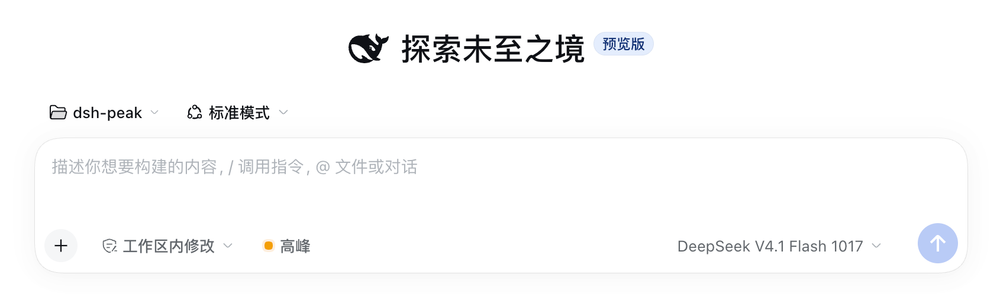
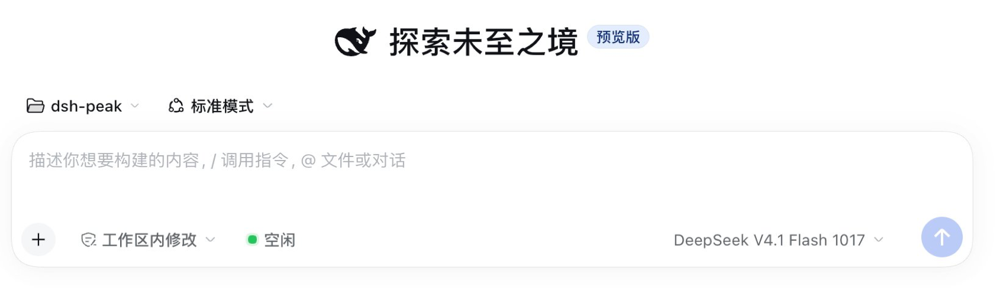
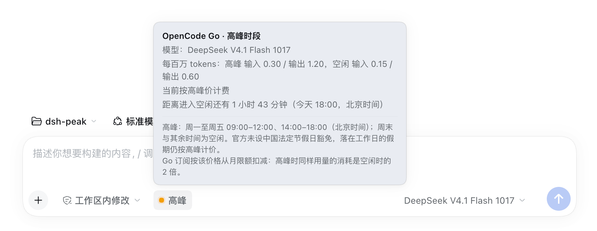

# Peak-hours badge (dsh-provider-peak)

[](https://github.com/moonmoonCL/dsh-provider-peak/actions/workflows/test.yml)
[](https://www.npmjs.com/package/dsh-provider-peak)

*[中文](README.md) · English*

A DSH (DeepSeek Harness) Web plugin. It renders a compact badge in the session composer toolbar showing whether the selected model is currently billed at **peak** or **off-peak** rates. The badge follows the model selected in the current Session and only appears for providers whose prices actually split by time of day.

Two provider families publish the same two windows:

- **DeepSeek's own API** (`deepseek-official` / `deepseek-account`, plus any route named DeepSeek): every model, with the Chinese public-holiday exemption.
- **OpenCode Go** (`opencode-go`): only `DeepSeek V4.1 Flash` and `DeepSeek V4 Pro`; same windows, but no holiday exemption (a weekday holiday stays at peak). Go's other models (GLM, Kimi, Qwen, MiMo, …) are flat-rate and show no badge.

- `● Off-peak` (green): off-peak hours, half of the peak rate
- `● Peak` (amber): peak hours, standard rate
- Hover or keyboard-focus the badge: it highlights and a tooltip opens with the provider, the current model, the per-1M-token peak/off-peak rates, time until the next switch, the switch instant (Beijing time), the rule, the holiday-data coverage, and Go's allowance warning. The tooltip hugs the badge, stays inside the window, and flips below the badge when there is not enough room above
- Flat-rate models (GLM, Kimi, …) and the pay-as-you-go Console provider (`opencode`) hide the badge
- An unresolved model selection renders a neutral `Unknown` chip
- Bilingual (Chinese / English), follows the UI locale; zero dependencies, no build step

## Screenshots

The badge lives in the composer toolbar: amber `Peak` bills the standard rate, green `Off-peak` bills half — shown only when the selected model really splits by time of day.

<p>
  
  
</p>

Hover it (or focus it with the keyboard) and a tooltip opens with the provider, the current model, the per-1M-token rates, the time until the next switch including the switch instant, and the full rule.



## Install

```sh
dsh plugin --profile web add dsh-provider-peak
```

### Plugin page (recommended)

1. Open DSH Web.
2. Go to **Settings → Plugins** and paste the package name:

   ```text
   dsh-provider-peak
   ```

3. Refresh the page after installation.

The GitHub repository tracks `main` and is a little ahead of releases; swap the package name for the URL to install it instead:

```text
https://github.com/moonmoonCL/dsh-provider-peak
```

### CLI

npm package:

```sh
dsh plugin --profile <profile> add dsh-provider-peak
```

Git repository (follows `main`, no release needed):

```sh
dsh plugin --profile <profile> add https://github.com/moonmoonCL/dsh-provider-peak
```

The `desktop` profile is managed by Electron and only accepts the UI path. Refresh the page after installation.

### Local development

```sh
git clone https://github.com/moonmoonCL/dsh-provider-peak
dsh plugin --profile web add /path/to/dsh-provider-peak
```

A directory install is a `link:`: edit `client.js`, refresh the page, and no reinstall is needed.

## Billing rule

| Period | Beijing time | Price |
| --- | --- | --- |
| Peak | Mon–Fri 09:00–12:00 and 14:00–18:00 | standard |
| Off-peak | every other instant, weekends in full | 50% of peak |

Both families share the windows and the 2x multiplier; they differ on holidays:

| Provider | A weekday inside a Chinese public holiday |
| --- | --- |
| DeepSeek's own API | off-peak all day |
| OpenCode Go | still peak (no exemption published) |

Sources: [DeepSeek API pricing](https://api-docs.deepseek.com/quick_start/pricing) and the [OpenCode Go usage-limit table](https://opencode.ai/docs/console/go/) (checked 2026-11-12).

OpenCode Go rates per 1M tokens (input / output):

| Model | Peak | Off-peak |
| --- | --- | --- |
| DeepSeek V4.1 Flash | $0.30 / $1.20 | $0.15 / $0.60 |
| DeepSeek V4 Pro | $1.32 / $3.96 | $0.66 / $1.98 |

Go is a subscription: usage is charged against the monthly limit, so peak usage burns twice the allowance of the same volume off-peak.

## Which providers show the badge

| Selected provider / model | Badge |
| --- | --- |
| `deepseek-official` / `deepseek-account` (bundled DeepSeek) | `Peak` / `Off-peak` |
| A provider named `DeepSeek` (e.g. a pi-ai route pointing at api.deepseek.com) | `Peak` / `Off-peak` |
| `opencode-go` with `deepseek-v4.1-flash` / `deepseek-v4-pro` (id with or without the `opencode-go/` prefix) | `Peak` / `Off-peak` |
| Other `opencode-go` models (GLM, Kimi, Qwen, MiMo, Grok, … — flat-rate) | hidden |
| `opencode` (Console pay-as-you-go; its DeepSeek models are flat too) | hidden |
| Any other provider (e.g. `xiaomi-token-plan-cn`, third-party gateways) | hidden |
| Model information unresolved / failed to load | `Unknown` |

The rules live in `DEEPSEEK_PROVIDER_IDS`, `OPENCODE_GO_PROVIDER_IDS`, and `OPENCODE_GO_PEAK_MODELS` (plus their name patterns) in `client.js`.

## Chinese public holidays

The 2026 State Council schedule ships with the plugin (seven holiday periods). A weekday inside one of them is off-peak all day — for DeepSeek's own API only; OpenCode Go ignores the table and keeps peak rates. When the 2027 schedule is published (usually November), update:

```js
const HOLIDAY_RANGES = [/* ... */];
const HOLIDAY_COVERAGE = '2026';
```

Years outside the table fall back to the weekday/window rule only; nothing breaks.

## Customize

| Change | Where |
| --- | --- |
| Provider allowlist | `DEEPSEEK_PROVIDER_IDS` / `DEEPSEEK_PROVIDER_NAME` and `OPENCODE_GO_PROVIDER_IDS` / `OPENCODE_GO_PROVIDER_NAME` in `client.js` |
| Which Go models split | `OPENCODE_GO_PEAK_MODELS` (name fallback: `OPENCODE_GO_PEAK_MODEL_NAME`) in `client.js` |
| Tooltip rates | `OPENCODE_GO_RATES` in `client.js` |
| Peak windows | `PEAK_WINDOWS` in `client.js` |
| Holidays | `HOLIDAY_RANGES` / `HOLIDAY_COVERAGE` in `client.js` |
| Wording | `DICT` (zh / en) in `client.js`; plugin-card text in `locale/*.json` |

Refresh the page (directory install) or reinstall (GitHub install) after editing.

## Layout

| File | Purpose |
| --- | --- |
| `client.js` | All browser-side logic: slot registration, locale dictionaries, model lookup, schedule computation, badge rendering |
| `index.js` | Empty Host plugin (all rendering is client-side) |
| `cordis.patch.yml` | Plugin row inserted on install |
| `locale/{zh,en}.json` | Plugin-manager title and description |
| `test/policy.test.mjs` | Schedule and provider/classification tests |
| `test/render.test.mjs` | Renders the real component against a React stub and asserts the chip label, the tooltip text, and that the tooltip is portaled and hidden until measured |
| `docs/verification.md` | Verification record and limits |
| `docs/images/{badge,tooltip}.png` | README screenshots |
| `icon.svg` | Plugin icon |

## Develop and test

```sh
node --check client.js
npm test
```

`policy.test.mjs` extracts the pure functions from the `// --- policy logic` block in `client.js`; `render.test.mjs` stubs `window.__ModuleLoader__` and React and renders the component for real. Neither needs a browser.

## Compatibility

- Developed and verified on DSH `0.2.0-rc.2`.
- Uses built-in Harness surfaces: the `conversation.input.left` slot, the `ctx.modelDirectories` service, `ctx.locale`, and `--dsw-alias-*` theme tokens.
- Only theme tokens are referenced, so light and dark themes follow the host; no Harness Client package is imported.
- A changed slot name, model-directory service, or locale API in DSH requires a matching update here.

## Verification

See [docs/verification.md](docs/verification.md). Unit tests, directory and GitHub installation, the live slot registration, and the tooltip placement against the host composer CSS (headless Chrome, before/after) were verified.

## License

[MIT](LICENSE)
