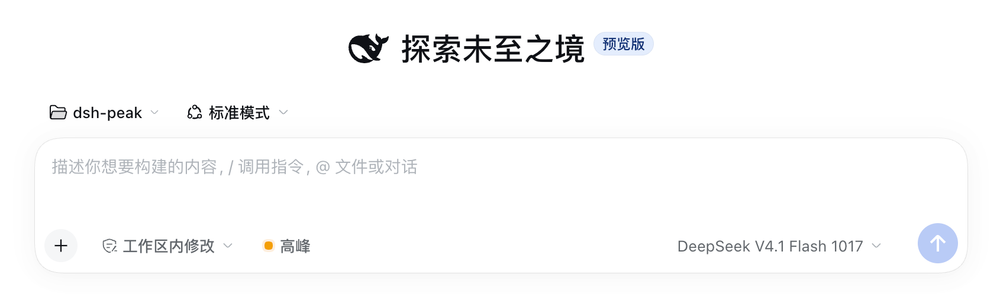
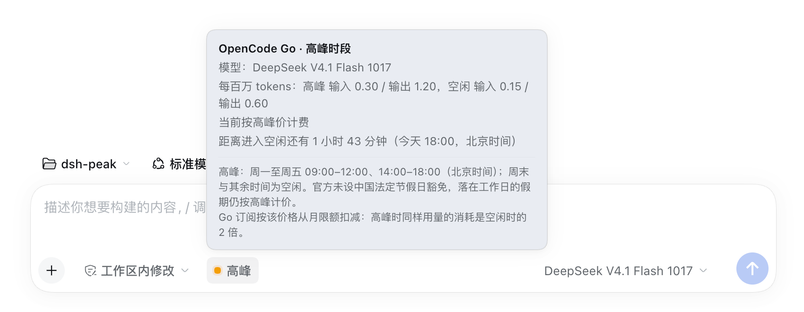

# 峰谷时段提示（dsh-provider-peak）

[](https://github.com/moonmoonCL/dsh-provider-peak/actions/workflows/test.yml)

DSH（DeepSeek Harness）Web 插件。在会话输入框工具栏常驻一枚小徽章，显示当前选中的模型是否按**高峰**价计费；徽章跟随当前选中的模型，只在价格确实分峰谷的 provider 上出现。

支持两类封顶相同的峰谷价：

- **DeepSeek 官方 API**（`deepseek-official` / `deepseek-account`，以及名称为 DeepSeek 的自建路由）：全部模型，工作日高峰、其余空闲，法定节假日按空闲。
- **OpenCode Go**（`opencode-go`）：只有 `DeepSeek V4.1 Flash` 与 `DeepSeek V4 Pro` 两个模型分峰谷；窗口与 DeepSeek 相同，但官方没有法定节假日豁免（工作日假期仍按高峰）。Go 的其余模型（GLM、Kimi、Qwen、MiMo 等）是单一价，不显示徽章。

- `● 空闲`（绿点）：空闲时段，价格为高峰价的 5 折
- `● 高峰`（黄点）：高峰时段，按标准价计费
- 悬停或键盘聚焦：徽章出现底色反馈，并弹出详情浮层（provider、当前模型、每百万 token 峰谷单价、距下次切换多久、切换时刻、计费规则、节假日数据覆盖年份、Go 的额度消耗提示）；浮层贴着徽章、始终留在窗口内，窗口变窄时自动翻到徽章下方
- 选中 GLM、Kimi 等单一价模型，或 Console 按量付费（`opencode`）等 provider：徽章自动隐藏
- 模型信息尚未解析或加载失败：灰色 `未知`
- 中英双语，跟随界面语言；零依赖、免构建，装上即用

## 展示

输入框工具栏里常驻的峰谷徽章：黄点 `高峰`、绿点 `空闲`，只在选中的模型确实按时段计价时出现。



悬停或用键盘聚焦徽章，浮层给出 provider、当前模型、每百万 token 的峰谷单价、距下次切换的时长（含切换时刻），以及完整的计费规则。



## 安装

```sh
dsh plugin --profile web add dsh-provider-peak
```

### 插件页（推荐）

1. 打开 DSH Web。
2. 进入 **设置 → 插件**，在安装框粘贴包名：

   ```text
   dsh-provider-peak
   ```

3. 安装后刷新页面。

仓库跟着 `main` 走，比 npm 版本更新；想装最新代码就把包名换成仓库地址：

```text
https://github.com/moonmoonCL/dsh-provider-peak
```

### 命令行

npm 包：

```sh
dsh plugin --profile <profile> add dsh-provider-peak
```

Git 仓库（跟随 `main`，无需等发版）：

```sh
dsh plugin --profile <profile> add https://github.com/moonmoonCL/dsh-provider-peak
```

`desktop` 配置档由 Electron 独占，只能走界面。安装后刷新页面。

### 本地开发

```sh
git clone https://github.com/moonmoonCL/dsh-provider-peak
dsh plugin --profile web add /path/to/dsh-provider-peak
```

目录安装是 `link:`，改完 `client.js` 刷新页面即可，不必重装。

## 峰谷规则

| 时段 | 北京时间 | 价格 |
| --- | --- | --- |
| 高峰 | 周一至周五 09:00–12:00、14:00–18:00 | 标准价 |
| 空闲 | 其余全部时间，含周末全天 | 高峰价的 50% |

两类 provider 的窗口与倍率相同，差在节假日：

| provider | 工作日落在法定节假日 |
| --- | --- |
| DeepSeek 官方 API | 全天空闲 |
| OpenCode Go | 仍按高峰计价（官方未设豁免） |

规则与价格来源：[DeepSeek 官方价格页](https://api-docs.deepseek.com/zh-cn/quick_start/pricing)、[OpenCode Go 用量限额表](https://opencode.ai/docs/console/go/)（核对于 2026-11-12）。

OpenCode Go 的峰谷单价（每百万 tokens，输入 / 输出）：

| 模型 | 高峰 | 空闲 |
| --- | --- | --- |
| DeepSeek V4.1 Flash | $0.30 / $1.20 | $0.15 / $0.60 |
| DeepSeek V4 Pro | $1.32 / $3.96 | $0.66 / $1.98 |

Go 是订阅制，费用从月限额里扣：高峰时同样用量的消耗是空闲时的 2 倍。

## 哪些 provider 会显示

| 选中的 provider / 模型 | 徽章 |
| --- | --- |
| `deepseek-official` / `deepseek-account`（内置 DeepSeek） | `高峰` / `空闲` |
| 名称为 `DeepSeek` 的 provider（如 pi-ai 里配置、指向 api.deepseek.com 的 `deepseek` 路由） | `高峰` / `空闲` |
| `opencode-go` 且模型为 `deepseek-v4.1-flash` / `deepseek-v4-pro`（id 带不带 `opencode-go/` 前缀都认） | `高峰` / `空闲` |
| `opencode-go` 的其他模型（GLM、Kimi、Qwen、MiMo、Grok 等，单一价） | 隐藏 |
| `opencode`（Console 按量付费，DeepSeek 也是单一价） | 隐藏 |
| 其他 provider（`xiaomi-token-plan-cn`、第三方中转等） | 隐藏 |
| 模型信息尚未解析 / 加载失败 | `未知` |

判定逻辑在 `client.js` 的 `DEEPSEEK_PROVIDER_IDS`、`OPENCODE_GO_PROVIDER_IDS`、`OPENCODE_GO_PEAK_MODELS`（以及对应的名称正则）里。

## 法定节假日

内置 2026 年国务院办公厅公布的 7 段假期（元旦、春节、清明、劳动节、端午、中秋、国庆），落在工作日的假期会让当天全天空闲——这条只作用于 DeepSeek 官方 API；OpenCode Go 不使用该表，工作日假期照常高峰。2027 年安排通常在 2026 年 11 月公布，届时更新 `client.js`：

```js
const HOLIDAY_RANGES = [/* ... */];
const HOLIDAY_COVERAGE = '2026';
```

节假日数据未覆盖的年份仍按“周一至周五 + 两个高峰窗口”判断，不会报错，只是不识别新年份的假期。

## 自定义

| 想改什么 | 位置 |
| --- | --- |
| provider 白名单 | `client.js` 的 `DEEPSEEK_PROVIDER_IDS` / `DEEPSEEK_PROVIDER_NAME`、`OPENCODE_GO_PROVIDER_IDS` / `OPENCODE_GO_PROVIDER_NAME` |
| Go 里哪些模型分峰谷 | `client.js` 的 `OPENCODE_GO_PEAK_MODELS`（及名称兜底 `OPENCODE_GO_PEAK_MODEL_NAME`） |
| 浮层里的单价 | `client.js` 的 `OPENCODE_GO_RATES` |
| 高峰窗口 | `client.js` 的 `PEAK_WINDOWS` |
| 节假日 | `client.js` 的 `HOLIDAY_RANGES` / `HOLIDAY_COVERAGE` |
| 文案 | `client.js` 的 `DICT`（zh / en）；插件卡标题在 `locale/*.json` |
| 浮层位置（边距、与徽章间距、上下翻转） | `client.js` 的 `VIEWPORT_MARGIN` / `ANCHOR_GAP` 与 `placementOf()` |

修改后刷新页面（目录安装）或重新安装（GitHub 安装）。

## 结构

| 文件 | 作用 |
| --- | --- |
| `client.js` | 全部浏览器端逻辑：槽位注册、locale 文案、选中模型读取、峰谷计算与徽章渲染 |
| `index.js` | Host 端空插件（渲染全部在 Client） |
| `cordis.patch.yml` | 安装时插入的插件行 |
| `locale/{zh,en}.json` | 插件管理页的标题与描述 |
| `test/policy.test.mjs` | 峰谷计算、provider/模型判定的单元测试 |
| `test/render.test.mjs` | 用假 React 跑真实组件，断言徽章标签、浮层文案，以及浮层被 portal 到 body 且测量前保持隐藏 |
| `docs/verification.md` | 验证记录与限制 |
| `docs/images/{badge,tooltip}.png` | README 展示截图 |
| `icon.svg` | 插件图标 |

## 开发与测试

```sh
node --check client.js
npm test
```

`policy.test.mjs` 从 `client.js` 的 `// --- policy logic` 标记块中取出纯函数执行（含浮层定位的 `placementOf`）；`render.test.mjs` 则桩掉 `window.__ModuleLoader__`、React 与 `react-dom`，真实渲染组件。两者都不需要浏览器。

## 兼容性

- 在 DSH `0.2.0-rc.2` 上开发与验证。
- 使用 Harness 自带能力：`conversation.input.left` 槽位、`ctx.modelDirectories` 服务、`ctx.locale`、`--dsw-alias-*` 主题 token。
- 只引用主题 token，深浅色主题都跟随宿主；除 `react` / `react-dom`（Harness 平台种子模块）外不引用任何包。
- 详情浮层挂在 `document.body` 上并按窗口坐标定位：输入框所在的会话面板在会话激活后会成为 `position: fixed` 的包含块（`will-change: transform`），且会话视图会裁掉溢出内容，浮层留在这个子树里就会被挪位或截断。
- DSH 若调整槽位名、模型目录服务或 locale API，需要跟着更新。

## 验证状态

见 [docs/verification.md](docs/verification.md)：逻辑单测、目录安装与 GitHub 安装、实时槽位注册、浮层定位（真实宿主 CSS + 无头 Chrome，改前/改后对照）均已覆盖。

## License

[MIT](LICENSE)
